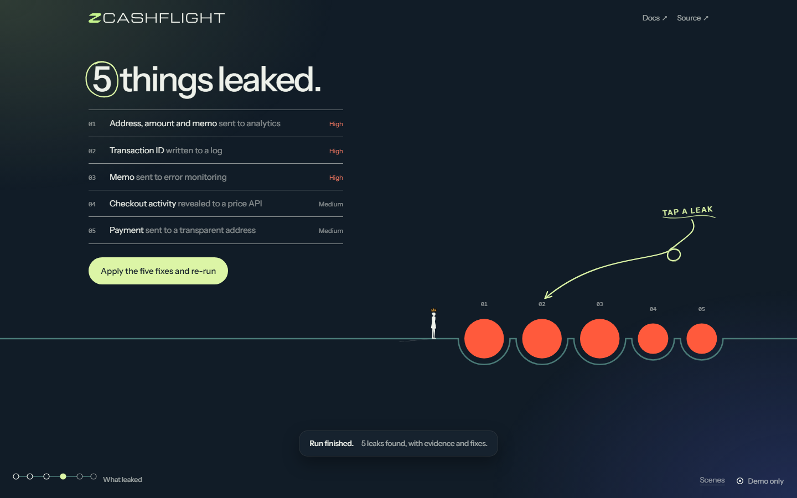
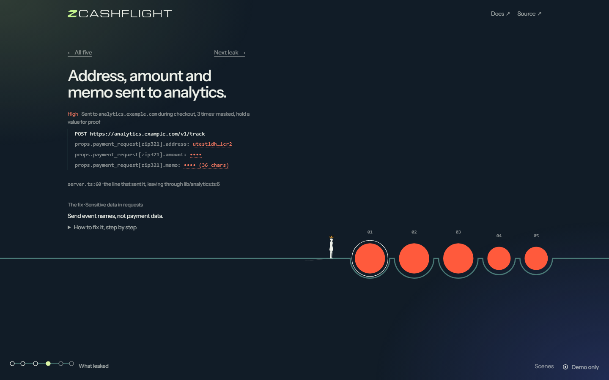
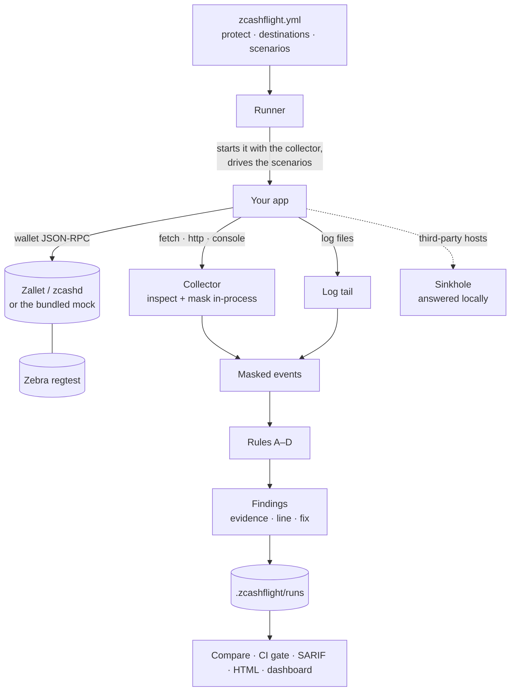
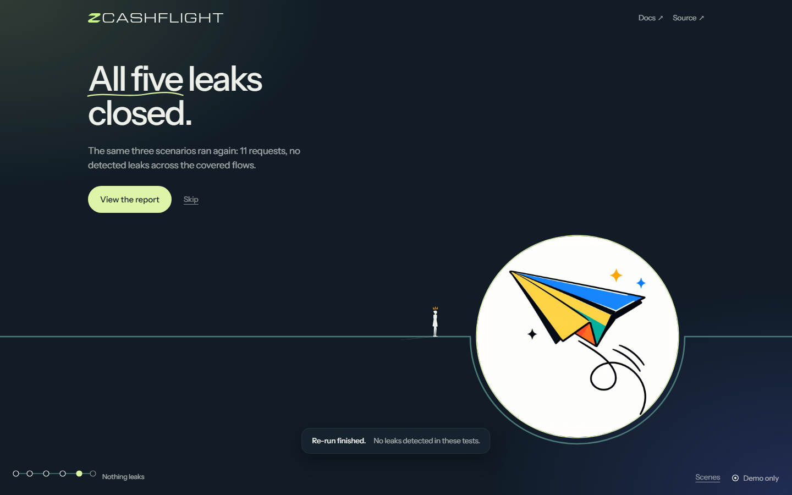

<p><picture><source media="(prefers-color-scheme: dark)" srcset="brand/logo/zcashflight-logo-ivory.svg"></picture></p>

# ZcashFlight — privacy tests for Zcash apps

**A CLI and GitHub Action that runs your Zcash app's real flows and catches leaked addresses, amounts, memos and transaction IDs before you ship.**

A shielded payment hides who paid whom and how much on chain, but the app around it can still send the address to analytics, the txid to a log, or the memo to an error tracker. ZcashFlight starts your app, drives its checkout, refund and error flows, and inspects every outbound request, console line, stdout write and log file. Each leak comes with masked evidence, the line of code that sent it, and a fix; then the same tests run again to prove it's closed, and the CI gate keeps it closed.

**For** merchant and payment backends, bots, explorers and web front ends. **Not for** mobile or Rust wallets directly: those are covered only through the [proxy](docs/guides/non-node-apps.md) (plain HTTP in full, HTTPS host only) or a [HAR export](docs/guides/browser-wallets.md).

```bash
git clone https://github.com/mauyaa/zcashflight && cd zcashflight && npm run demo
```

### Measured, not promised

Run on 21 Oct 2026 · Windows 11 · Node 24.18.0 · commit `7238064` (tests, validation and the demo from a fresh clone; the real-chain proof in a clean checkout of the same commit).

| What | Command | Result |
|---|---|---|
| Real Zcash chain: Zebra + Zallet regtest, real transactions | `npm run regtest` | 5 leaks found → fixes applied → all 5 closed; CI gate exit 1 → 0; 8 transactions mined (blocks 343–358) |
| Mock-wallet sample (no Docker) | `npm run demo` | 5 leaks → 0; CI gate exit 1 → 0 |
| Detection corpus: distinct seeded exposures and look-alikes | `npm run validate` | 54 / 54 found · 0 / 26 false positives · 0 raw values stored |
| Leak channels (base64, gzip, FormData, Blob, stream, batch, query, stdout, console) | `npm test` (`test/channels.test.ts`) | 9 / 9 reference channels found (was 3 / 9 on 21 Oct before the fix), plus ReadableStream |
| Unreadable bodies | `npm test` | reported as uninspected, never as clean; `strict: true` fails the gate |
| Everything | `npm test` | 115 / 115 pass |

These are synthetic fixtures and a deliberately leaky sample app built for this repository. Two independent open-source projects have also been run, with synthetic data: one real finding, fixed and verified closed, and one clean result (see [tested on real projects](#tested-on-real-projects)). A clean run means no leaks were detected in the tested scenarios, never a privacy guarantee.

**Live site:** [zcashflight.vercel.app](https://zcashflight.vercel.app) is a recorded replay of the sample app, not a scanner: it can't test your project. The real tool runs on your machine.

**Status:** prototype · v0.1.0 · Node 22.18 or later · Windows, macOS, Linux · MIT licence · built for [ZECATHON 2026](https://thezecathon.com), Core & Tooling track



---

## The problem

A shielded Zcash transaction hides the sender, the recipient and the amount on chain. The app around it often doesn't. The checkout page sends its payment request to an analytics SDK. A debug log keeps the transaction ID. An error reporter attaches the memo. A refund goes to an old transparent address. Each mistake publishes, off chain, what the user chose to shield, and functional tests never notice, because the payment still works.

Zcash's own guidance warns that metadata outside the chain can link activity ([Zcash privacy recommendations](https://zcash.readthedocs.io/en/latest/rtd_pages/privacy_recommendations_best_practices.html)). Today developers check for this by reading code and watching traffic by hand. That's slow, it isn't repeatable, and it doesn't stop the same leak coming back next month.

## Why it has to be Zcash-specific

A generic secret scanner doesn't know what a Zcash address is, so it either misses them or flags every long string. ZcashFlight recognises Zcash data by its real encoding:

- **Addresses and keys** by their Bech32 / Bech32m / Base58Check checksums and HRPs: unified (ZIP 316), Sapling, TEX (ZIP 320), transparent, Sprout, viewing keys, spending keys and WIF.
- **Payment requests** by parsing ZIP 321 `zcash:` URIs exactly as the spec requires, then reporting the address, amount and memo they carry.
- **Seed phrases** against the BIP-39 word list.
- **Amounts, memos and txids** by the field or context they appear in.
- **Wallet sends** by reading `z_sendmany` calls: which pools the recipients are in, and whether the privacy policy allows revealing them.

A transparent payment isn't automatically a leak: the policy says whether this app must stay shielded (`transactions.shielded_only`).

## What it detects

| Rule | Catches | Severity |
|---|---|---|
| **A** · Sensitive data in requests | Protected data (including a ZIP 321 payment request) sent to a host the policy doesn't approve for it | High; critical for spending keys and seed phrases |
| **B** · Sensitive data in logs | Protected data written to the console or log files | High; critical for keys and seeds |
| **C** · Transaction type and public exposure | Wallet sends to transparent or TEX recipients, from transparent sources, or with a revealing `privacyPolicy`, when the app must stay shielded | Medium |
| **D** · Third-party data flows | Calls to hosts the policy hasn't approved, which reveal *that* a payment happened, and when | Medium |

Every finding records the rule, severity, destination, the kind of data and how it was recognised (checksum, ZIP 321, word list or field name), the redacted evidence, the scenario and step that triggered it, a fix, and the source line **only when a stack frame proves it**. A HAR import or proxy capture has no stack, so those findings carry no code location. Details: [rules](docs/reference/rules.md) · [detection](docs/reference/detection.md).



## How it works



*Text alternative:* the runner reads the policy, starts your app with the collector loaded, and drives its scenarios. The collector inspects every request and console line inside the app process and masks protected values before anything is stored; log files are tailed and masked the same way. Requests to unapproved third parties are answered locally, so test data never reaches them. Deterministic rules turn the masked events into findings, which are saved locally, compared with the previous run of the same app, and turned into a CI exit code, SARIF, HTML or Markdown, or shown in the local dashboard. More: [architecture](docs/architecture/overview.md).

## Requirements

- **Node 22.18 or later** (it runs TypeScript directly). No runtime dependencies.
- **For the real-chain proof:** Docker with Compose 2.24.4+, plus the Zcash Foundation's [Z3](https://github.com/ZcashFoundation/z3) stack (Zebra and Zallet).
- Dev-only: `typescript` and `@types/node`, for `npm run typecheck`.

## Try it

### In 30 seconds: the sample app with a mock wallet

```bash
git clone https://github.com/mauyaa/zcashflight
```
```bash
cd zcashflight && npm ci
```
```bash
npm run demo
```

**What you should see:** `5 privacy leaks found.` for ZecShop, then the same scenarios after the code fixes with all five closed, and finally `CI gate: before fixes exit 1 (fails the build), after fixes exit 0 (passes).` Then `npm run ui` opens the same journey in the local dashboard.

### On a real Zcash chain: Zebra + Zallet regtest

With the Z3 regtest stack running ([step-by-step guide](docs/guides/regtest.md)):

```bash
npm run regtest
```

ZecShop then takes real shielded payments, sweeps funds and issues refunds through Zallet, mined by Zebra. ZcashFlight finds the leaks in real values, the fixes are applied, and the same scenarios pass. This output is from a run on 21 Oct 2026 at commit `7238064` (masked values are real regtest addresses and txids):

```
5 privacy leaks found.
  high     Address, amount and memo sent to analytics
           A · to analytics.example.com · server.ts:60
           body.props.payment_request[zip321].address: uregtest1vl…3fjh (checksum ✓)
           body.props.payment_request[zip321].amount: •••• (ZIP 321 ✓)
           body.props.payment_request[zip321].memo: •••• (36 chars) (ZIP 321 ✓)
  high     Transaction ID written to a log            B · to logs/server.log · server/broadcast.ts:9
  high     Memo sent to error monitoring              A · to errors.example.io · server.ts:92
  medium   Checkout activity revealed to a price API  D · to api.coingecko.com · lib/prices.ts:5
  medium   Payment sent to a transparent address      C · to 127.0.0.1:50232 · lib/refund.ts:9
  tested:  checkout · refunds · errors · Observed: fetch (63), console (1), log files (4) · Log files: logs/server.log · Wallet RPC sends (4)
…
All 5 leaks closed. No leaks detected in these tests.
Regtest chain: blocks 343–358, 8 non-coinbase transactions built by Zallet and mined by Zebra during this proof.
CI gate: before fixes exit 1 (fails the build), after fixes exit 0 (passes).
```

What is real and what is a test harness (the customer's wallet, block mining) is spelled out in the [regtest guide](docs/guides/regtest.md#what-is-real-and-what-is-a-test-harness).

### On your own app

```bash
zcashflight init
```

Edit `zcashflight.yml` (where your app listens, which hosts may receive what, and one real flow), then `zcashflight run`. Full walkthrough: [quickstart](docs/start/quickstart.md) · [run it in CI](docs/guides/run-in-ci.md) · [non-Node apps](docs/guides/non-node-apps.md) · [browser wallets (HAR)](docs/guides/browser-wallets.md).



## Tests you can run

| Level | Command | What it proves | Result on 21 Oct 2026 (commit `7238064`) |
|---|---|---|---|
| Unit and integration | `npm test` | Encodings against BIP-173/350 vectors; ZIP 321 against the ZIP's own examples; every corpus case; masking never stores a raw value; the body reader (encodings, caps, decompression bombs); rules, policies, comparisons, the dashboard API; ZecShop end to end with the mock wallet | 115 / 115 pass |
| Leak channels, live | `npm test` (`test/channels.test.ts`) | The reference app sends one synthetic address or txid through each channel: JSON, base64, gzip, FormData, Blob, batch array, query string, `process.stdout`, `console.log`, plus a ReadableStream; unreadable bodies are reported, and `strict: true` fails the gate | 9 / 9 reference channels (+ stream); 4 / 4 unreadable bodies reported |
| Non-Node proxy, live | `npm test` (`test/proxy.test.ts`) | A Python app: plain-HTTP leak found; its HTTPS request reported as uninspected (host only) | pass (skipped with a reason if no Python 3) |
| Detection corpus | `npm run validate` | 54 distinct seeded exposures must be found and 26 look-alikes must stay silent (file and commit hashes, JWTs, Bitcoin and Ethereum addresses, fiat totals, ordinary base64, invalid ZIP 321 URIs…) | 54 / 54 found · 0 / 26 false positives · 0 raw values stored |
| Before / after (mock wallet) | `npm run demo` | The leaky sample fails the CI gate, the fixed one passes | exit 1 → exit 0 |
| Before / after (real chain) | `npm run regtest` | The same, against Zebra + Zallet regtest with real transactions | exit 1 → exit 0, 8 transactions mined |
| Types, build and package | `npm run typecheck` · `npm run build` · `npm pack` | Strict TypeScript; the packed tarball installs into an empty project and runs `version`, `init`, `synth` and `run` from `dist/` | pass |
| Layout | [`test/ui-audit.js`](test/ui-audit.js) in a browser | 18 dashboard screens at 11 sizes from 320 to 1920 px: no sideways scroll, no hidden overflow, every target at least 24 px | 18 / 18 at every size |

CI runs typecheck, tests, validation, the demo and a built-package run on Windows, macOS and Linux with Node 22 and 24 ([workflow](.github/workflows/ci.yml)), and uses the action itself the way another repository would ([action workflow](.github/workflows/action-test.yml)). The regtest proof needs Docker and runs locally.

## Detection surfaces

| Surface | Covered | How |
|---|---|---|
| `fetch`, `node:http`, `node:https` from a Node app | Yes: URL, headers (never credentials) and body | In-process collector loaded with `node --import` |
| Request bodies | string, bytes, `URLSearchParams`, `Blob`, `FormData`, `ReadableStream`, `Request`; gzip / deflate / br; base64 values. Up to 5 MB each | [Bodies that need decoding](docs/reference/detection.md#bodies-that-need-decoding) |
| `console.*`, `process.stdout` / `stderr`, raw writes to fd 1 / 2 | Yes | Same collector; the app's own output is passed through unchanged |
| Log files you list | Yes | Tailed during the run |
| Wallet JSON-RPC sends (`z_sendmany`, `sendtoaddress`, `sendmany`, `z_shieldcoinbase`) | Yes: recipients' pools and privacy policy | Parsed from the captured request |
| Node child processes | Yes, when they inherit `NODE_OPTIONS` (the default) | Observed with `npm start` spawning `node` |
| Non-Node apps (Rust, Go, Python…) | Plain HTTP in full; HTTPS host only, reported as uninspected | Local proxy via `HTTP(S)_PROXY`; tested with a Python app |
| Browser wallets and front ends | Offline | HAR export: `zcashflight scan file.har` |

**What ZcashFlight can't see is never reported as clean.** A body it can't read (unknown type, over 5 MB, malformed or unsupported compression, binary, an encrypted HTTPS tunnel) is listed under "Not inspected" in the CLI, reports, SARIF tool notifications and the dashboard; with `strict: true` it fails the CI gate.

### Not tested

- **Not instrumented at all:** `node:http2`, WebSocket, raw TCP/TLS/UDP sockets (`node:net`, `node:tls`, `node:dgram`), undici used directly (not through global `fetch`), worker threads, child processes that are not Node (`curl`, …). Every live report lists these.
- **Not decrypted:** HTTPS bodies through the proxy (host only). ZcashFlight installs no certificate authority.
- **Not in scope:** IP addresses and transport timing; mobile apps; code paths your scenarios don't exercise; what the app's own stdout, log files and third-party logging sinks receive (ZcashFlight inspects them but does not rewrite or sanitise them).
- **Detection limits:** an amount is recognised by its field name (`amount`, `zats`, `price`…), a ZEC/TAZ/zats unit, a ZIP 321 request, or a decimal beside an address; a bare number with none of these is not. `price` / `total` with no currency field are treated as amounts. Unified-address receivers are resolved by the wallet (`z_listunifiedreceivers`), not decoded locally.
- **Mainnet:** the live proofs use regtest and synthetic identifiers: no real funds, users or production endpoints. Mainnet encodings (`u1…`, `zs1…`, `t1…`, `tex1…`, `uview1…`, mainnet spending keys) are recognised and covered by the corpus with synthetic values; that shows the detectors parse them, not that every mainnet flow is covered.

## Tested on real projects

Run on 21 Oct 2026 against fresh local clones, with synthetic data only (no real funds, users, accounts or production endpoints; third-party calls answered locally). Both are anonymised until their maintainers have been contacted.

| Project | What was exercised | Result |
|---|---|---|
| [A: event ticket checkout](docs/case-studies/project-a.md) (Next.js, pays through a Zcash payment processor) | the processor's signed and unsigned payment webhooks | **2 high findings:** the payment txid written to the console log next to the invoice id (which another log line ties to the attendee's email). A two-line fix closed both; the project's own tests still pass. Disclosure drafted, not sent |
| [B: signed merchant invoices](docs/case-studies/project-b.md) (zero-dependency reference checkout) | registry, invoice signing, a refused client-supplied amount | No leaks detected in these tests |

Neither run covers the whole project: project A's checkout needs a live event-platform API and was not exercised. Four other candidates were looked at and not run, because their flows need production services, operator databases or paid APIs that can't be replaced safely with synthetic data. Running project A also found a ZcashFlight bug (startup traffic was blamed on the first scenario), now fixed.

## Use it in CI

```yaml
# .github/workflows/privacy.yml
name: privacy
on: pull_request
jobs:
  zcashflight:
    runs-on: ubuntu-latest
    permissions: { contents: read, security-events: write }
    steps:
      - uses: actions/checkout@v5
      # install your app's own dependencies here, e.g. npm ci
      - uses: mauyaa/zcashflight@7238064c05f1d32e559ac0c136bf1176246e5123   # v0.1.0 code; its "action" workflow is green
        with: { dir: ., fail-on: medium, sarif: zcashflight.sarif }
      - uses: github/codeql-action/upload-sarif@v3
        if: always()
        with: { sarif_file: zcashflight.sarif }
```

The action is tested in this repository by using it exactly as another repository would ([`action-test.yml`](.github/workflows/action-test.yml): the leaky sample must fail, the fixed one must pass, strict mode must fail on unreadable bodies). Use from a separate repository has not been verified yet. More: [run it in CI](docs/guides/run-in-ci.md).

## Privacy of the tool itself

- **Masked at capture:** protected values are replaced before anything is written. Stored references use a per-run keyed hash, so they can't be reversed or linked across runs.
- **No key material collected:** keys and seed phrases are detected only to report them; there's nothing to configure that would make ZcashFlight read a wallet's keys.
- **No secrets in reports:** source lines are used to choose the line to blame but never copied into stored findings, and auth headers are never inspected or stored.
- **Nothing leaves the machine:** third-party requests are answered locally during tests. There is no telemetry. The dashboard listens on 127.0.0.1 only, behind a per-session token.
- **Fails safe:** a run whose app didn't start, whose steps failed or that was stopped is marked incomplete, closes nothing and exits 2 in CI.

It isn't a network sandbox or a general-purpose secret scrubber: use test data and review artifacts before sharing. Full detail: [PRIVACY.md](PRIVACY.md) · [threat model](docs/trust/threat-model.md).

## Limitations

ZcashFlight checks the observable behaviour of the scenarios you give it. It doesn't decrypt shielded transactions, deanonymise anyone, scan other people's wallets, or provide network anonymity (for that, see Nym or Tor). A clean run means no leaks were detected in these tests, not that an app is private, and every report lists what was not tested ([full list](#not-tested)).

## Documentation

| I want to… | Go to |
|---|---|
| Try it on my app | [Quickstart](docs/start/quickstart.md) |
| See it on a real Zcash chain | [Zebra + Zallet regtest](docs/guides/regtest.md) |
| Learn by fixing a leak step by step | [Tutorial](docs/start/tutorial.md) |
| Add it to CI | [Run in CI](docs/guides/run-in-ci.md) |
| Test a Rust, Go or Python app · a browser wallet | [Non-Node apps](docs/guides/non-node-apps.md) · [HAR export](docs/guides/browser-wallets.md) |
| Look up a flag, a policy key or a rule | [CLI](docs/reference/cli.md) · [Policy](docs/reference/policy.md) · [Rules](docs/reference/rules.md) · [Detection](docs/reference/detection.md) |
| Review security and data handling | [Threat model](docs/trust/threat-model.md) · [PRIVACY.md](PRIVACY.md) · [SECURITY.md](SECURITY.md) |
| Fix a problem | [Troubleshooting](docs/guides/troubleshooting.md) |

Full index: [docs/](docs/README.md)

## Built for ZECATHON 2026

ZcashFlight was written for ZECATHON 2026 (build window 28 Sep – 28 Oct 2026), Core & Tooling track. All of its code and assets date from 18 Oct 2026 onwards; the first commit in this repository collects the first two days of work, and every change since is its own commit. It is open source from submission, under the MIT licence.

## Licence and attribution

MIT ([LICENSE](LICENSE)). Bundled fonts (Instrument Sans, Michroma; SIL OFL) and the BIP-39 word list are listed in [THIRD_PARTY_NOTICES.md](THIRD_PARTY_NOTICES.md). The regtest proof uses [Z3](https://github.com/ZcashFoundation/z3), [Zebra](https://github.com/ZcashFoundation/zebra) and [Zallet](https://github.com/zcash/zallet) as run-time tools; none of their code is included here.

[Changelog](CHANGELOG.md) · [Contributing](CONTRIBUTING.md) · [Security policy](SECURITY.md)
