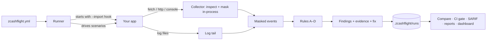

# ZcashFlight — privacy tests for Zcash apps

**ZcashFlight helps Zcash wallet and payment developers find and fix privacy leaks before release, by running their app's real flows and checking every request and log line against a privacy policy.**

**Status:** prototype · v0.1.0 · Node 22.18 or later · Windows, macOS, Linux · MIT licence

**Live demo:** [zcashflight.vercel.app](https://zcashflight.vercel.app), a recorded run against the ZecShop sample app.

---

## The problem

A shielded Zcash transaction hides the sender, the recipient and the amount on chain. The app around it often doesn't. A checkout sends the recipient and amount to an analytics SDK. A debug log keeps the transaction ID. An error reporter attaches the memo. A refund goes to an old transparent address. Each of these publishes, off chain, what the user chose to shield, and functional tests never notice, because the payment still works.

Zcash's own guidance warns that metadata outside the chain can link activity ([Zcash privacy recommendations](https://zcash.readthedocs.io/en/latest/rtd_pages/privacy_recommendations_best_practices.html)). Today, developers check for this by reading code and watching network traffic by hand. That is slow, it isn't repeatable, and it doesn't stop the same leak coming back next month.

## What ZcashFlight does

It starts your app, drives the scenarios you describe (checkout, refunds, errors) and inspects every outbound request, console line and log file. Zcash data is recognised by its real encoding: unified, Sapling, TEX and transparent addresses, viewing keys and spending keys are checked against their Bech32, Bech32m and Base58Check checksums, and seed phrases against the BIP‑39 word list. Each finding comes with masked evidence, the line of code that sent the value, and a fix. After you fix it, the same scenarios run again and the result shows what closed.

| Capability | Status |
|---|---|
| Run an app's scenarios and capture requests and logs, masked at capture | Available |
| Rules A–D: data in requests, data in logs, transparent exposure, third‑party flows | Available |
| Re-run and compare (closed / still open / new) | Available |
| CI gate, SARIF for GitHub code scanning, HTML and Markdown reports | Available |
| Local dashboard, plus a hosted replay of a recorded run | Available |
| Non-Node apps through a local proxy (HTTPS: host only) | Available |
| Browser wallets through HAR import | Available |
| Network-layer metadata (IP address, transport timing) | Not supported. See [what it is not](#what-it-is-not) |
| Integration with a live zallet / zebrad regtest network | Planned. ZecShop uses a mock wallet RPC today |

## First result in two minutes

You need Node 22.18 or later and Git.

```bash
git clone https://github.com/mauyaa/zcashflight
```
```bash
cd zcashflight
```
```bash
npm run demo
```

**What you should see:** `5 privacy leaks found.` for the ZecShop sample, then `run N → run N+1: clean` with all five listed as closed, and finally `CI gate: before fixes exit 1 (fails the build), after fixes exit 0 (passes).`

Then open the dashboard and walk the same journey:

```bash
npm run ui
```

Next: [use it on your own app](docs/start/quickstart.md) · [run it in CI](docs/guides/run-in-ci.md)

## How it works



*Text alternative:* the runner reads the policy, starts the app with the collector loaded, and drives its scenarios. The collector masks what the app sends and logs before anything is written. Deterministic rules turn those masked events into findings, which are stored locally and compared, gated, reported or shown in the dashboard. More detail: [architecture](docs/architecture/overview.md).

## Evidence

Every number below can be reproduced in this repository.

| Claim | How to check |
|---|---|
| Detects 16 of 16 seeded exposures, 0 of 5 false positives, 0 raw values stored | `npm run validate` ([cases](test/cases.ts)) |
| Finds exactly the five ZecShop leaks at the right lines; zero after the fixes; same fingerprint on a repeat run; no raw value in stored files | `npm test` ([test/zecshop.test.ts](test/zecshop.test.ts)) |
| Seeded app fails CI, fixed app passes | `npm run demo` |
| Dashboard passes 18 of 18 layout checks (no sideways scroll, no hidden overflow, every target at least 24 px) at 320, 390, 768, 1024, 1366, 1440 and 1920 px | [test/ui-audit.js](test/ui-audit.js), see [design system](docs/design/design-system.md#tested) |
| The dashboard makes zero third-party requests | Bundled fonts and images; CSP `default-src 'self'` |

## Privacy of the tool itself

Recognised protected values are masked before capture is written; new findings retain code locations without copying source literals. Intercepted third-party requests are answered locally during tests. With the sinkhole enabled, automatic fetch redirects are rejected so they cannot bypass the collector. This is not a network sandbox or a general-purpose secret scrubber: use synthetic data and review artifacts before sharing. The dashboard listens on 127.0.0.1 behind a session token. There is no telemetry and there are no runtime dependencies. Full detail: [PRIVACY.md](PRIVACY.md) · [threat model](docs/trust/threat-model.md).

## What it is not

ZcashFlight checks observable application behaviour in the scenarios you give it. It does not decrypt shielded transactions, deanonymise anyone, scan other people's wallets, or provide network anonymity (for that, see Nym or Tor). It cannot see IP addresses or transport timing, or code paths your scenarios don't exercise. A clean run means no leaks were detected in these tests, not that an app is private in every circumstance, and every report lists what was not tested.

## Documentation

| I want to… | Go to |
|---|---|
| Try it on my app | [Quickstart](docs/start/quickstart.md) |
| Learn by fixing a leak step by step | [Tutorial: find and fix your first leak](docs/start/tutorial.md) |
| Add it to CI | [Run in CI](docs/guides/run-in-ci.md) |
| Test a Rust, Go or Python app | [Test a non-Node app](docs/guides/non-node-apps.md) |
| Test a browser wallet | [Scan a HAR export](docs/guides/browser-wallets.md) |
| Fix a problem | [Troubleshooting](docs/guides/troubleshooting.md) |
| Look up a flag, a policy key or a rule | [CLI](docs/reference/cli.md) · [Policy](docs/reference/policy.md) · [Rules](docs/reference/rules.md) · [Detection](docs/reference/detection.md) |
| Understand why this exists | [Product brief](docs/overview/product-brief.md) · [Application-layer privacy](docs/concepts/application-layer-privacy.md) |
| Review security and data handling | [Threat model](docs/trust/threat-model.md) · [PRIVACY.md](PRIVACY.md) · [SECURITY.md](SECURITY.md) |

Full index: [docs/](docs/README.md)

## Links

[Changelog](CHANGELOG.md) · [Contributing](CONTRIBUTING.md) · [Security policy](SECURITY.md) · [Licence (MIT)](LICENSE) · Built for [Zecathon](https://thezecathon.com), Core & Tooling track
