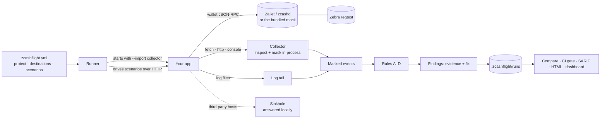

<p><picture><source media="(prefers-color-scheme: dark)" srcset="brand/logo/zcashflight-logo-ivory.svg"></picture></p>

# ZcashFlight — privacy tests for Zcash apps

**Run a privacy test. See the evidence. Fix the exposure. Verify the result.**

ZcashFlight runs your Zcash app's real flows (checkout, refunds, errors) and checks every outbound request, console line and log file against a privacy policy. When an address, amount, memo, transaction ID or key escapes to somewhere it shouldn't, you get the masked evidence, the line of code that sent it, and a fix. Then the same tests run again to prove it's closed.

**Status:** prototype · v0.1.0 · Node 22.18 or later · Windows, macOS, Linux · MIT licence · built for [ZECATHON 2026](https://thezecathon.com), Core & Tooling track

**Live demo:** [zcashflight.vercel.app](https://zcashflight.vercel.app), a recorded run against the ZecShop sample app.


---

## The problem

A shielded Zcash transaction hides the sender, the recipient and the amount on chain. The app around it often doesn't. The checkout page sends its payment request to an analytics SDK. A debug log keeps the transaction ID. An error reporter attaches the memo. A refund goes to an old transparent address. Each mistake publishes, off chain, what the user chose to shield, and functional tests never notice, because the payment still works.

Zcash's own guidance warns that metadata outside the chain can link activity ([Zcash privacy recommendations](https://zcash.readthedocs.io/en/latest/rtd_pages/privacy_recommendations_best_practices.html)). Today developers check for this by reading code and watching traffic by hand. That's slow, it isn't repeatable, and it doesn't stop the same leak coming back next month.

## Why it has to be Zcash-specific

A generic secret scanner doesn't know what a Zcash address is, so it either misses them or flags every long string. ZcashFlight recognises Zcash data by its real encoding:

- **Addresses and keys** by their Bech32 / Bech32m / Base58Check checksums and HRPs: unified (ZIP 316), Sapling, TEX (ZIP 320), transparent, Sprout, viewing keys, spending keys and WIF.
- **Payment requests** by parsing ZIP 321 `zcash:` URIs exactly as the spec requires, then reporting the address, amount and memo they carry.
- **Seed phrases** against the BIP-39 word list.
- **Amounts, memos and txids** by the field or context they appear in.
- **Wallet sends** by reading `z_sendmany` calls: which pools the recipients are in, and whether the privacy policy allows revealing them.

A transparent payment isn't automatically a leak: the policy says whether this app must stay shielded (`transactions.shielded_only`).

## What it detects

| Rule | Catches | Severity |
|---|---|---|
| **A** · Sensitive data in requests | Protected data (including a ZIP 321 payment request) sent to a host the policy doesn't approve for it | High; critical for spending keys and seed phrases |
| **B** · Sensitive data in logs | Protected data written to the console or log files | High; critical for keys and seeds |
| **C** · Transaction type and public exposure | Wallet sends to transparent or TEX recipients, from transparent sources, or with a revealing `privacyPolicy`, when the app must stay shielded | Medium |
| **D** · Third-party data flows | Calls to hosts the policy hasn't approved, which reveal *that* a payment happened, and when | Medium |

Every finding records the rule, severity, destination, the kind of data and how it was recognised (checksum, ZIP 321, word list or field name), the redacted evidence, the scenario and step that triggered it, a fix, and the source line **only when a stack frame proves it**. A HAR import or proxy capture has no stack, so those findings carry no code location. Details: [rules](docs/reference/rules.md) · [detection](docs/reference/detection.md).


## How it works



*Text alternative:* the runner reads the policy, starts your app with the collector loaded, and drives its scenarios. The collector inspects every request and console line inside the app process and masks protected values before anything is stored; log files are tailed and masked the same way. Requests to unapproved third parties are answered locally, so test data never reaches them. Deterministic rules turn the masked events into findings, which are saved locally, compared with the previous run of the same app, and turned into a CI exit code, SARIF, HTML or Markdown, or shown in the local dashboard. More: [architecture](docs/architecture/overview.md).

## Requirements

- **Node 22.18 or later** (it runs TypeScript directly). No runtime dependencies.
- **For the real-chain proof:** Docker with Compose 2.24.4+, plus the Zcash Foundation's [Z3](https://github.com/ZcashFoundation/z3) stack (Zebra and Zallet).
- Dev-only: `typescript` and `@types/node`, for `npm run typecheck`.

## Try it

### In 30 seconds: the sample app with a mock wallet

```bash
git clone https://github.com/mauyaa/zcashflight
```
```bash
cd zcashflight && npm ci
```
```bash
npm run demo
```

**What you should see:** `5 privacy leaks found.` for ZecShop, then the same scenarios after the code fixes with all five closed, and finally `CI gate: before fixes exit 1 (fails the build), after fixes exit 0 (passes).` Then `npm run ui` opens the same journey in the local dashboard.

### On a real Zcash chain: Zebra + Zallet regtest

With the Z3 regtest stack running ([step-by-step guide](docs/guides/regtest.md)):

```bash
npm run regtest
```

ZecShop then takes real shielded payments, sweeps funds and issues refunds through Zallet, mined by Zebra. ZcashFlight finds the leaks in real values, the fixes are applied, and the same scenarios pass. This output is from a run on 20 Oct 2026 (masked values are real regtest addresses and txids):

```
5 privacy leaks found.
  high     Address, amount and memo sent to analytics
           A · to analytics.example.com · server.ts:60
           body.props.payment_request[zip321].address: uregtest10f…fhna (checksum ✓)
           body.props.payment_request[zip321].amount: •••• (ZIP 321 ✓)
           body.props.payment_request[zip321].memo: •••• (36 chars) (ZIP 321 ✓)
  high     Transaction ID written to a log            B · to logs/server.log · server/broadcast.ts:9
  high     Memo sent to error monitoring              A · to errors.example.io · server.ts:92
  medium   Checkout activity revealed to a price API  D · to api.coingecko.com · lib/prices.ts:5
  medium   Payment sent to a transparent address      C · to 127.0.0.1:50232 · lib/refund.ts:9
…
All 5 leaks closed. No leaks detected in these tests.
Regtest chain: blocks 276–291, 8 non-coinbase transactions built by Zallet and mined by Zebra during this proof.
CI gate: before fixes exit 1 (fails the build), after fixes exit 0 (passes).
```

What is real and what is a test harness (the customer's wallet, block mining) is spelled out in the [regtest guide](docs/guides/regtest.md#what-is-real-and-what-is-a-test-harness).

### On your own app

```bash
zcashflight init
```

Edit `zcashflight.yml` (where your app listens, which hosts may receive what, and one real flow), then `zcashflight run`. Full walkthrough: [quickstart](docs/start/quickstart.md) · [run it in CI](docs/guides/run-in-ci.md) · [non-Node apps](docs/guides/non-node-apps.md) · [browser wallets (HAR)](docs/guides/browser-wallets.md).


## Tests you can run

| Level | Command | What it proves | Result on 20 Oct 2026 |
|---|---|---|---|
| Unit and integration | `npm test` | Encodings against BIP-173/350 vectors; ZIP 321 against the ZIP's own examples; masking never stores a raw value; rules, policies, comparisons, the dashboard API; ZecShop end to end with the mock wallet | 55 / 55 pass |
| Detection corpus | `npm run validate` | 19 seeded exposures must be found and 8 look-alikes (approved wallet RPC, shielding coinbase, a transparent payout the policy allows, hashes, prose…) must stay silent | 19 / 19 found · 0 / 8 false positives · 0 raw values stored |
| Before / after (mock wallet) | `npm run demo` | The leaky sample fails the CI gate, the fixed one passes | exit 1 → exit 0 |
| Before / after (real chain) | `npm run regtest` | The same, against Zebra + Zallet regtest with real transactions | exit 1 → exit 0, 8 transactions mined |
| Types and build | `npm run typecheck` · `npm run build` | Strict TypeScript; the npm package builds and runs from `dist/` | pass |
| Layout | [`test/ui-audit.js`](test/ui-audit.js) in the browser | 18 dashboard screens at 10 sizes from 320 to 1920 px: no sideways scroll, no hidden overflow, every target at least 24 px | 18 / 18 at every size |

CI runs typecheck, tests, validation, the demo and a built-package run on Windows, macOS and Linux with Node 22 and 24 ([workflow](.github/workflows/ci.yml)). The regtest proof needs Docker and runs locally.

## Detection surfaces

| Surface | Covered | How |
|---|---|---|
| Outbound `fetch`, `http`, `https` from a Node app | Yes, full URL, headers (not credentials) and body | In-process collector loaded with `node --import` |
| Console output | Yes | Same collector |
| Log files you list | Yes | Tailed during the run |
| Wallet JSON-RPC sends (`z_sendmany`, `sendtoaddress`, `sendmany`) | Yes, recipients' pools and privacy policy | Parsed from the captured request |
| Non-Node apps (Rust, Go, Python…) | Plain HTTP in full; HTTPS host only (never decrypted) | Local proxy via `HTTP(S)_PROXY` |
| Browser wallets and front ends | Yes, offline | HAR export: `zcashflight scan file.har` |
| IP addresses, transport timing, mobile apps | No | Out of scope; see below |

## Privacy of the tool itself

- **Masked at capture:** protected values are replaced before anything is written. Stored references use a per-run keyed hash, so they can't be reversed or linked across runs.
- **No key material collected:** keys and seed phrases are detected only to report them; there's nothing to configure that would make ZcashFlight read a wallet's keys.
- **No secrets in reports:** source lines are used to choose the line to blame but never copied into stored findings, and auth headers are never inspected or stored.
- **Nothing leaves the machine:** third-party requests are answered locally during tests. There is no telemetry. The dashboard listens on 127.0.0.1 only, behind a per-session token.
- **Fails safe:** a run whose app didn't start, whose steps failed or that was stopped is marked incomplete, closes nothing and exits 2 in CI.

It isn't a network sandbox or a general-purpose secret scrubber: use test data and review artifacts before sharing. Full detail: [PRIVACY.md](PRIVACY.md) · [threat model](docs/trust/threat-model.md).

## Limitations

ZcashFlight checks the observable behaviour of the scenarios you give it. It doesn't decrypt shielded transactions, deanonymise anyone, scan other people's wallets, or provide network anonymity (for that, see Nym or Tor). It can't see IP addresses or transport timing, or code paths your scenarios don't exercise. Unified-address receivers are resolved by the wallet (`z_listunifiedreceivers`), not decoded locally. A clean run means no leaks were detected in these tests, not that an app is private, and every report lists what was not tested.

## Documentation

| I want to… | Go to |
|---|---|
| Try it on my app | [Quickstart](docs/start/quickstart.md) |
| See it on a real Zcash chain | [Zebra + Zallet regtest](docs/guides/regtest.md) |
| Learn by fixing a leak step by step | [Tutorial](docs/start/tutorial.md) |
| Add it to CI | [Run in CI](docs/guides/run-in-ci.md) |
| Test a Rust, Go or Python app · a browser wallet | [Non-Node apps](docs/guides/non-node-apps.md) · [HAR export](docs/guides/browser-wallets.md) |
| Look up a flag, a policy key or a rule | [CLI](docs/reference/cli.md) · [Policy](docs/reference/policy.md) · [Rules](docs/reference/rules.md) · [Detection](docs/reference/detection.md) |
| Review security and data handling | [Threat model](docs/trust/threat-model.md) · [PRIVACY.md](PRIVACY.md) · [SECURITY.md](SECURITY.md) |
| Fix a problem | [Troubleshooting](docs/guides/troubleshooting.md) |

Full index: [docs/](docs/README.md)

## Licence and attribution

MIT ([LICENSE](LICENSE)). Bundled fonts (Instrument Sans, Michroma; SIL OFL) and the BIP-39 word list are listed in [THIRD_PARTY_NOTICES.md](THIRD_PARTY_NOTICES.md). The regtest proof uses [Z3](https://github.com/ZcashFoundation/z3), [Zebra](https://github.com/ZcashFoundation/zebra) and [Zallet](https://github.com/zcash/zallet) as run-time tools; none of their code is included here.

[Changelog](CHANGELOG.md) · [Contributing](CONTRIBUTING.md) · [Security policy](SECURITY.md)
