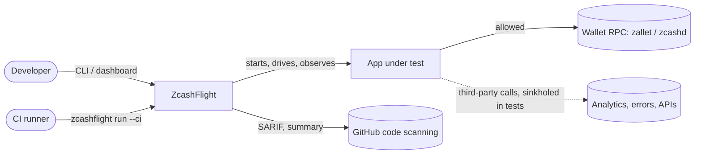
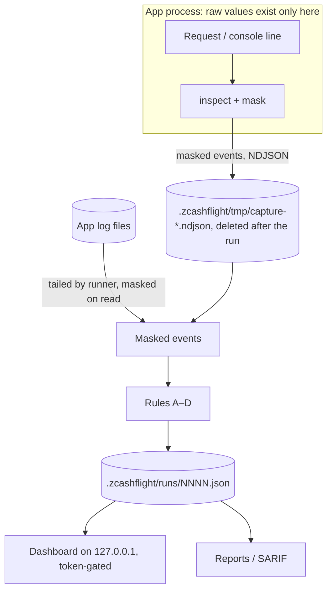
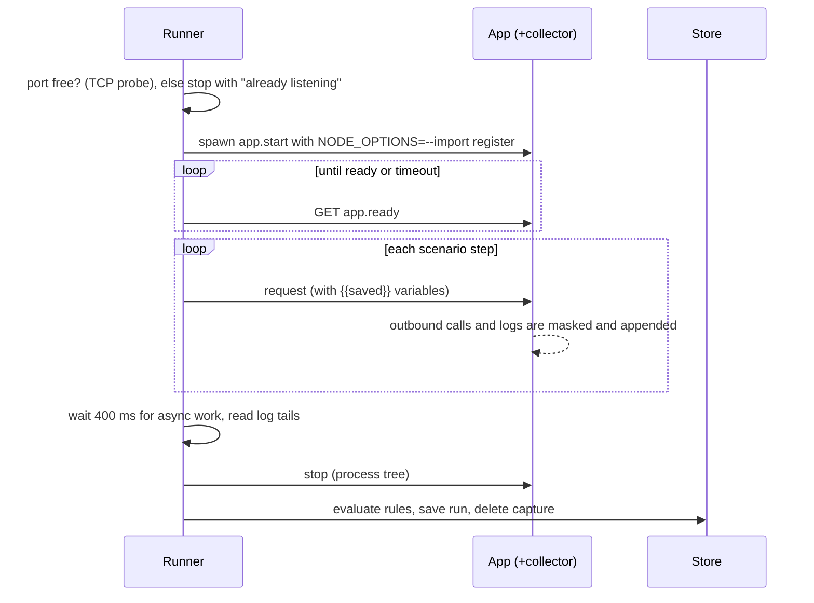

# Architecture

This describes the system as it exists in v0.1.0, not a plan.

## System context

**Legend:** solid arrows are real traffic. The dotted arrow is traffic the app tries to send; ZcashFlight answers it locally instead. *Text alternative:* a developer or CI runner uses ZcashFlight, which starts and observes the app under test. The app talks to its wallet RPC; its calls to third parties are intercepted and answered locally. CI receives SARIF and a summary.

## Components

| Component | Source | Responsibility |
|---|---|---|
| Detection | `src/zcash/` | Bech32, Bech32m and Base58Check decoding; identifier classification; text and JSON scanning; synthetic test data |
| Collector | `src/capture/register.ts` | Loaded into the app with `node --import`; patches `fetch`, `http(s).request` and `console`; records project stack frames; sinkholes non-local hosts |
| Inspector | `src/capture/inspect.ts` | Turns a raw request or log line into a **masked** event; parses wallet RPC sends |
| Proxy and importers | `src/capture/proxy.ts`, `importers.ts` | HTTP forward proxy (HTTPS host only); HAR and log import |
| Policy | `src/engine/policy.ts`, `yaml.ts` | Loads and validates `zcashflight.yml` |
| Runner | `src/engine/runner.ts` | Starts the app, waits for ready, runs scenarios, tails logs, builds the run |
| Rules | `src/engine/rules.ts` | Deterministic rules A–D, grouping, code origin, remediation |
| Store and compare | `src/engine/store.ts` | `.zcashflight/runs/`, run comparison, baseline |
| Reports | `src/engine/report.ts` | Markdown, HTML, SARIF |
| Dashboard | `src/server/server.ts`, `ui/` | Local API and journey UI; recorded mode for the hosted demo |
| CLI | `src/cli/main.ts`, `bin/` | Commands and exit codes |

There are no runtime dependencies. TypeScript runs directly on Node 22.18 or later; `npm run build` emits plain JavaScript for npm installs ([ADR 0001](adr/0001-zero-dependencies.md)).

## Data flow and trust boundaries

*Text alternative:* raw values exist only inside the app process and, for log files, in the runner's memory while it reads a line. Both mask before writing. The capture file holds masked events and is deleted after each run. The run file holds masked findings. The dashboard and reports read only the run file.

| Boundary | What crosses | Control |
|---|---|---|
| App process → disk | Masked events only | Masking in `inspect.ts` before `appendFileSync` |
| Runner ↔ app | Per-run HMAC key via environment variable; scenario HTTP requests | The key is random per run and never written |
| App → internet (during tests) | Nothing, for non-local hosts | Sinkhole (fetch: synthetic `202`; http(s): local sink server) |
| Browser → dashboard | API calls | 127.0.0.1 bind, Host check, session token, CSP |

Detail: [threat model](../trust/threat-model.md).

## Sequence of a run

**Failure paths:** app exits before ready → `failed` with the last stderr lines. Not ready in time → `failed`. A step can't connect → `incomplete` ("stopped: … didn't run"). No events at all → `incomplete` ("silent"). Aborted from the dashboard → `incomplete`.

## Decision records

- [0001 Zero runtime dependencies](adr/0001-zero-dependencies.md)
- [0002 Mask at capture](adr/0002-mask-at-capture.md)
- [0003 Deterministic rules, no AI judgement](adr/0003-deterministic-rules.md)
- [0004 Sinkhole third-party calls by default](adr/0004-sinkhole-by-default.md)
- [0005 Keep the concept palette](adr/0005-concept-palette.md)
